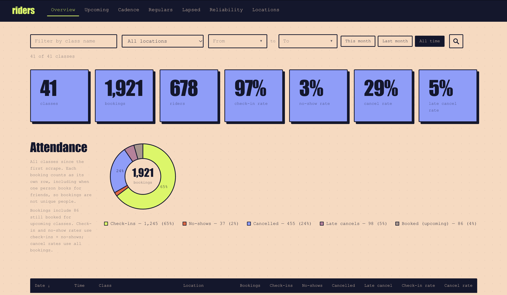
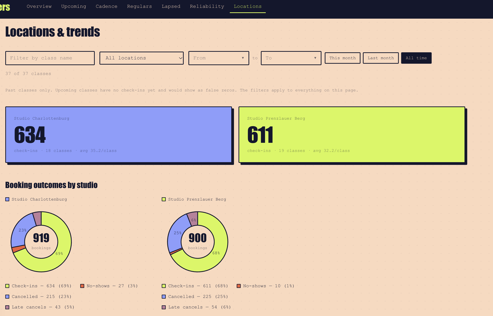
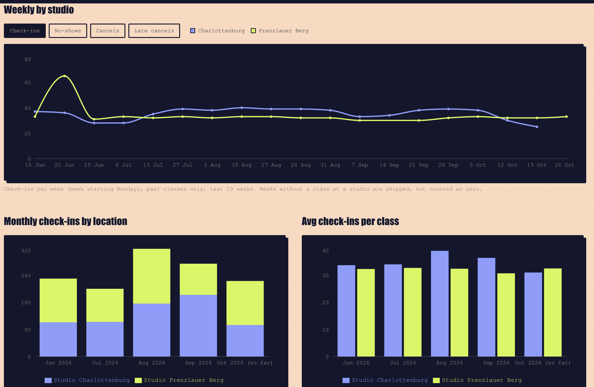

# riders

A local attendance dashboard for my indoor cycling classes. A small scraper pulls class
bookings from Momence into SQLite once a week, and a Next.js dashboard turns them into
answers: who comes, how often, who stopped cominge, and how each studio is
doing.

Everything runs on my laptop. Customer data stays in a git-ignored `data/` folder and never
leaves the machine.



## What it shows

| Page | What you get |
|------|--------------|
| **Overview** | Classes, bookings, riders, check-in / no-show / cancel rates and a booking-outcome donut. Filter by class name, studio and date range; everything updates together |
| **Upcoming** | Next classes by date, with studio and who is booked |
| **Cadence** | Riders grouped by how many classes they have attended |
| **Regulars** | Top riders by classes attended, with favourite studio and day |
| **Lapsed** | One-and-done riders and regulars who have not been back in a while |
| **Reliability** | How each rider's bookings end: attended, no-show, cancelled, late cancel |
| **Locations** | Per-studio check-ins, outcomes, best time slots, weekly and monthly trends |
| **Rider profile** | Full visit history and upcoming bookings for one rider |

Cadence, Regulars, Lapsed and Reliability can be filtered by studio, and every page with
riders has a search button to jump straight to someone's profile.





## How it works

```
Momence ──(Playwright, weekly)──▶ backend/scraper ──▶ data/ride.db (SQLite) ──▶ frontend (Next.js)
```

- **Scraper** (`backend/scraper/`, Python): logs in with a saved browser session, calls
  Momence's JSON API for each class, and upserts classes, customers and bookings. Re-running
  it is safe; it only adds what changed.
- **Dashboard** (`frontend/`, Next.js + TypeScript + Tailwind + Recharts): server components
  read the SQLite file directly (read-only). There is no API server in between.
- **API** (`backend/api/`, optional): a small read-only FastAPI layer over the same database.

## Getting started

You need Python 3.9+ and Node 20.

### 1. Scraper

```bash
python -m venv .venv
source .venv/bin/activate
pip install -r backend/requirements.txt -r backend/requirements-dev.txt
playwright install chromium

cp .env.example .env        # add your Momence email and password
chmod 600 .env

cd backend/scraper
python login.py             # once, and again whenever the session expires
python scrape.py --since 2026-06-01   # first backfill
```

After the first backfill, `make scrape` re-scrapes the last 10 days. It skips the run if it
already ran in the last 6 days (`--force` overrides that).

| Flag | What it does |
|------|--------------|
| `--since YYYY-MM-DD` | Scrape everything from this date |
| `--days N` | Re-scrape classes from the last N days (default 10) |
| `--force` | Run even if a scrape ran recently |
| `--har FILE…` | Replay recorded responses instead of calling the site (tests) |

### 2. Dashboard

```bash
cd frontend
npm install
npm run dev                 # or `make dev` from the root
```

Open http://localhost:3000. The dashboard reads `data/ride.db`; set `DB_PATH` to point it
somewhere else. More detail in [frontend/README.md](frontend/README.md).

### 3. Weekly schedule (macOS, optional)

`backend/launchd/` has a launchd job that runs the scraper every Tuesday at 09:00 (or on wake
if the laptop was asleep) and logs to `data/scrape.log`. Adjust the paths in the plist, then:

```bash
cp backend/launchd/*.plist ~/Library/LaunchAgents/
launchctl load ~/Library/LaunchAgents/com.juan.ride-analytics.plist
```

### Optional API

```bash
make api                    # http://127.0.0.1:8000/docs
```

## Development

```bash
make lint       # ruff check + format check (backend)
make test       # pytest (backend)
make fe-lint    # tsc + ESLint (frontend)
make fe-test    # Vitest (frontend)
```

CI runs the same checks on every push, and pre-commit runs ruff and a secret scanner before
each commit.

## Project layout

```
riders-attendance/
├── backend/
│   ├── scraper/      scrape.py, login.py, sources.py, schema.sql, migrations/, tests/
│   ├── api/          optional FastAPI layer
│   └── launchd/      macOS schedule
├── frontend/         Next.js dashboard
├── docs/screenshots/ images for this README
└── data/             git-ignored: ride.db, browser profile, logs
```

## Privacy

- Real customer names live only in `data/`, which is git-ignored.
- Tests and fixtures use made-up names.
- `.env`, cookies, the browser profile and `.har` recordings are never committed.
- The screenshots in this README show totals only, no names.
